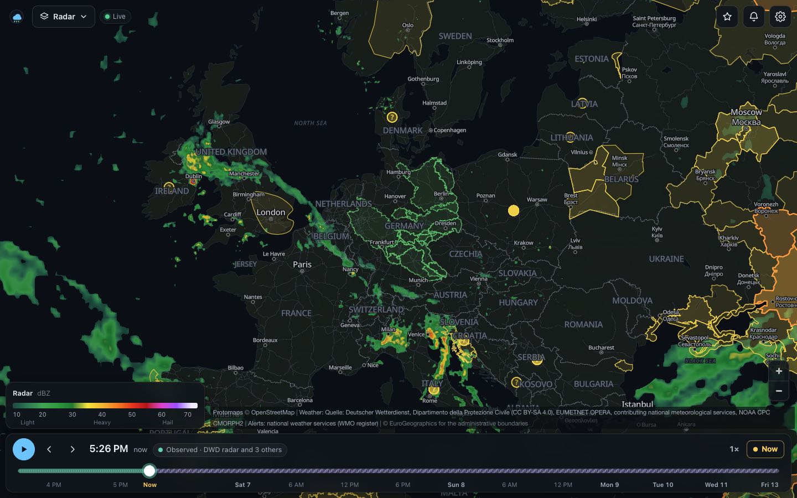

# Live weather map

A live weather map of the whole world, built as a mosaic of 43 public data
sources: radar composites, satellite imagery, analyses, and regional and global
forecast models, composited per tile on the server so the sharpest source is
always on top. Severe-weather alerts from about 150 national services, with
push notifications for your saved places.

Rust server (axum, PostGIS, pure-Rust GRIB2/HDF5 decoding) and a TypeScript
client (MapLibre GL, WebGL2 shaders colouring raw-value tiles).



## Run it

```sh
docker compose up -d db
cp .env.example .env               # set UPSTREAM_USER_AGENT
./scripts/fetch-basemap.sh         # 1.6 GB world basemap
(cd web && npm ci && npm run build)
cargo run --release -p wx-server   # http://127.0.0.1:8080
```

With every source on it downloads about 90 GB a day; `FEEDS` selects a subset.

## Read more

- [The full guide](docs/guide.md): what it shows, how it works, configuration, deployment, limits.
- [Sources](docs/sources/README.md): every source, its licence, credit and daily volume.
- [Wire protocol](docs/protocol.md): endpoints, events, the tile format.

Weather data from NOAA, ECCC, DWD, DMI, Météo-France, CPTEC/INPE, EUMETNET
OPERA, DPC, JMA, CWA, CPC and the national services in the WMO register;
basemap by Protomaps and © OpenStreetMap contributors.
