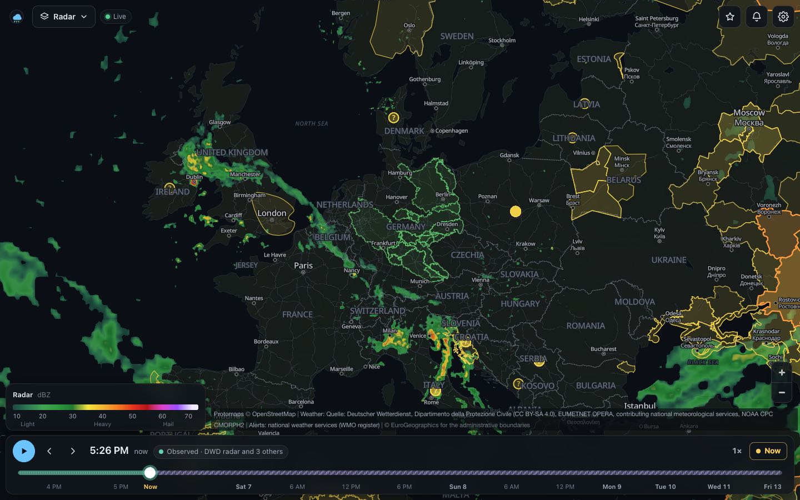
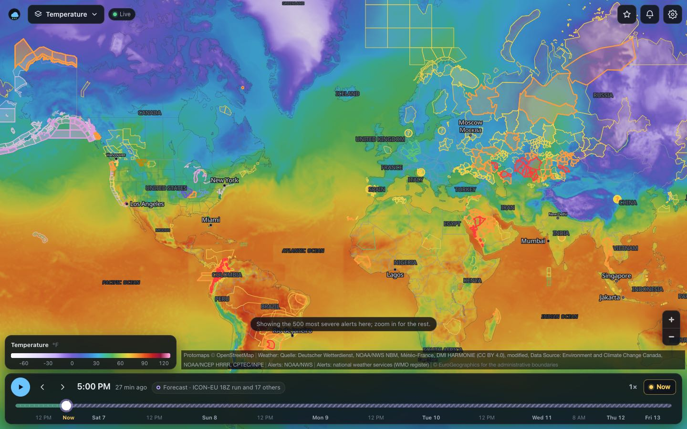
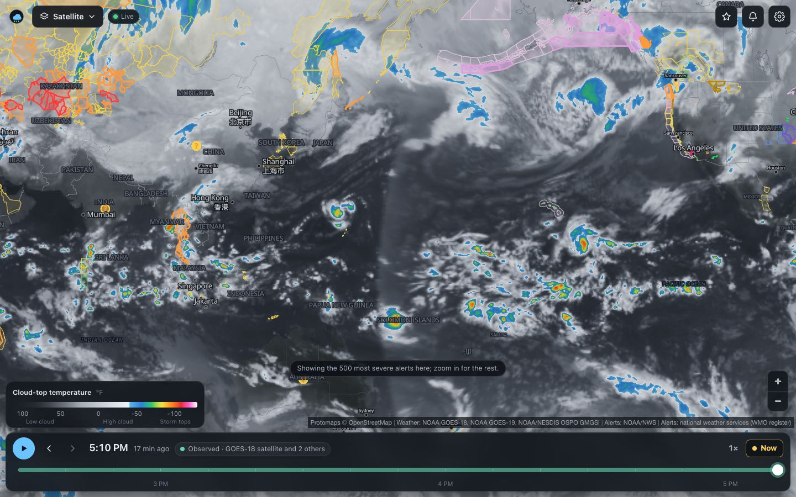
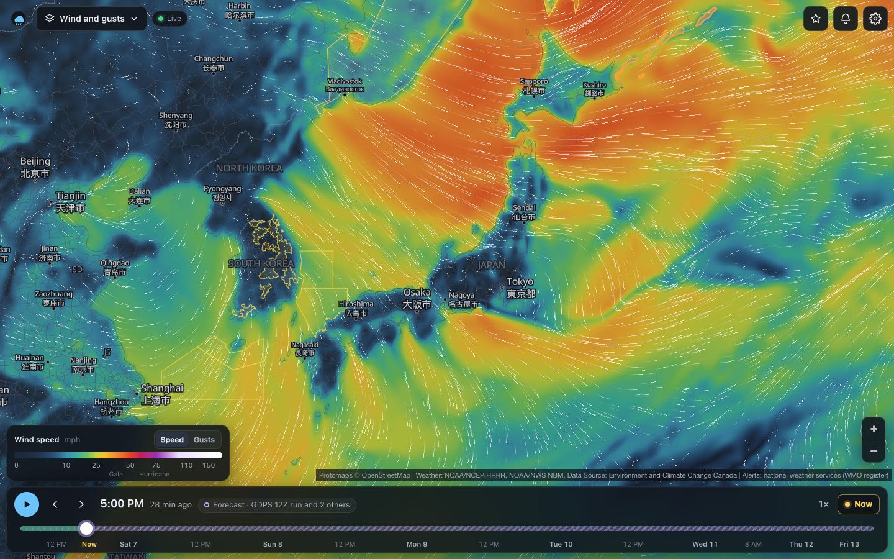

# Live weather map: the full guide

A web weather map of the whole world with a layer menu. It shows current
conditions, forecasts, satellite imagery and severe-weather alerts, built as
a mosaic of 43 public data sources (radars, analyses, regional and global
models, satellites) that are composited on the server so the sharpest source
is always on top. It sends a push notification when a warning covers one of
your saved places, from the US National Weather Service or from about 150
other national weather services.



| | |
|---|---|
|  |  |
|  | |

## What you can see

- **Radar**: live composites from the US (five MRMS domains: the lower 48,
  Alaska, Hawaii, the Caribbean, Guam), Europe (the OPERA composite of about
  24 countries), Germany, Italy, Japan and Taiwan, every 2 to 10 minutes.
  Everywhere else a satellite rainfall estimate (CMORPH2, half-hourly) stands
  in. The time slider runs from the last two hours of real radar into radar
  nowcasts (Germany, Japan) and the models' simulated radar.
- **Current conditions**: temperature, feels-like, dew point and wind from
  hourly analyses where they exist (RTMA for the US and its territories) and
  from the models' latest hours elsewhere; rainfall totals over the past 1,
  24 and 72 hours (radar in the US, satellite estimate worldwide); about
  7,300 station reports as dots (airports worldwide, NOAA buoys, Japan's
  AMeDAS network). Wind can be drawn as moving particles, arrows, or colour.
- **Forecast**: temperature, wind and gusts, precipitation type and rate,
  cloud cover, snowfall and simulated radar, hourly out to seven days, from
  the best model available at each place: 2 to 3 km models over the US and
  Alaska (HRRR, NBM), Canada (HRDPS), central Europe (ICON-D2), north-west
  Europe and Greenland (DMI HARMONIE), France and its overseas territories
  (AROME); 6.5 km ICON-EU over Europe; 7 km CPTEC over South America; and
  Canada's 15 km GDPS as the global base, with GFS beneath it and beyond its
  hourly range.
- **Satellite**: a global infrared cloud mosaic every hour (GMGSI) with
  10-minute GOES imagery over the Americas and the Pacific.
- **Point forecast**: tap anywhere for an hourly and daily forecast: from the
  NWS inside the US, from MET Norway everywhere else.
- **Alerts**: active warnings from the NWS and from the WMO register of
  national alerting feeds, drawn on the map, listed in their own languages,
  and pushed to saved places.
- **Status page** (`/status.html`): every feed's health, what each source is
  delivering, and what the server has downloaded from each host.

`sources/README.md` lists every source with its coverage, resolution,
cadence, licence and required credit, the sources considered and not used,
and the ones that would need a free account.

## How it works

```text
43 public sources                 Rust server (one process)                      Browser
─────────────────                 ─────────────────────────                      ───────
NOAA buckets (MRMS, RTMA,   ─┐   one adapter per family: notice new files,  ┌──▶ MapLibre GL + Protomaps basemap
 HRRR, NBM, GFS, GOES, GMGSI)│   fetch only the fields a layer needs        │    WebGL shader colours raw values
ECCC, DWD, DMI, Météo-France,├─▶ decode (GRIB2, HDF5, GeoTIFF, PNG) ─▶       │    time slider, hover values with
 CPTEC, OPERA, DPC, JMA, CWA,│   derive ─▶ one "part" per source and time   │    provenance, unit and palette
 CPC CMORPH2                ─┘   ─▶ stored grid (object store)              │    switching, credits for what
                                 catalog: each time step = a stack of parts ├──▶ is in view
                                 tiles composited on request from the stack │
api.weather.gov + 150 CAP feeds ─▶ PostGIS: shapes, zones, saved places      ├──▶ WebSocket: "timeline changed",
                                  ─▶ spatial match ─▶ Web Push               │    "alerts changed"
aviationweather.gov, NDBC, JMA ──▶ station dots                             └──▶ vector tiles of alerts
```

**One pipeline for every source.** A source is a row in a registry
(`crates/wx-core/src/families/`): where its data lives, which fields feed
which layer, how decoded values become the layer's bands, its cadence, and
its rank. The fetching, decoding, cataloguing, tile rendering and the client
are generic over that table; adding a region of a known family is one row,
and adding a family is one adapter file.

**A mosaic, not a choice.** Each layer keeps one timeline. A time step is a
stack of parts, one per source that has data for that moment, ordered by rank
(observations over analyses over fine models over coarse ones). Tiles are
rendered from the stack: the top part wins where it has data, with a soft
blend about twelve grid cells wide at its edge, and the next part shows
through where it does not. The rules for which parts make up a time step
(cadences, how long a part stands in, what happens at the edge of the loop,
how accumulation layers move from one model run to the next) are in
`crates/wx-core/src/frame.rs`.

**Tiles are named by their inputs.** A tile's URL lists the parts it is made
from, so when one source updates, only the tiles it touches change and every
cache keeps working. The browser decides which parts a tile needs with the
same rule the server uses (`protocol.md`). Tiles store values, not
colours (the WXT1 format, `crates/wx-tile`); the browser colours them in a
shader, so switching palettes or units is instant and the value under the
cursor is exact.

**Provenance.** The readout says which source a value comes from, confirmed
by the server (`/api/provenance`), and the credits line names every source
in view.

**Reliability.** Each source is its own supervised task, restarted with
backoff when it fails; a late model run keeps being looked for; a transient
failure is never remembered as a fact. The status page shows each feed's
state, newest data and last error.

The wire protocol (endpoints, WebSocket events, tile format) is in
[`protocol.md`](protocol.md).

### Repository layout

| Path | What it is |
|---|---|
| `crates/wx-core` | Shared contracts: the source and layer registries (`families/`), projections, the part/frame catalog, events, feed supervision |
| `crates/wx-tile` | The WXT1 tile codec (pure Rust, no I/O) |
| `crates/wx-tile-wasm` | The same decoder behind a C ABI, built as a WebAssembly module for the browser |
| `crates/wx-pipeline` | GRIB2 decoding (simple, complex, PNG, JPEG 2000 and CCSDS packing), derived fields, the quantized grid with coverage weights, the tile compositor |
| `crates/wx-formats` | Readers for HDF5/NetCDF-4 (radar composites, satellite products), GeoTIFF, palette PNG tiles and JSON grids, in pure Rust |
| `crates/wx-ingest` | The feeds: one adapter per source family, the generic drivers, per-host politeness, the janitor |
| `crates/wx-alerts` | NWS and worldwide CAP alerts in PostGIS, saved places, Web Push, vector tiles, and their HTTP routes |
| `crates/wx-obs` | Station observations and the point forecast, with caching |
| `crates/wx-server` | The server binary: API, tiles, WebSocket, persistence, wiring |
| `web/` | The client: TypeScript, React, MapLibre GL, WebGL2 shaders ([its README](../web/README.md)) |
| `migrations/` | Database schema |
| `fixtures/` | Real samples from every source family, used by the tests |
| `sources/` | The source catalogue and the research notes behind it |

## Running it locally

You need a current stable Rust toolchain and Node (developed on Rust 1.98
and Node 26; older versions are untested), and Docker for the database.

```sh
docker compose up -d db              # PostgreSQL + PostGIS on 127.0.0.1:5433
cp .env.example .env                 # then edit UPSTREAM_USER_AGENT (see below)
./scripts/fetch-basemap.sh           # 1.6 GB Protomaps world extract into data/basemap/
cargo run --release -p wx-server -- gen-vapid    # paste the two lines into .env
rustup target add wasm32-unknown-unknown         # once, for the WebAssembly decoder
(cd web && npm ci && npm run build:wasm && npm run build)
cargo run --release -p wx-server
```

`npm run build:wasm` is optional: without it the client decodes tiles in
TypeScript.

Open <http://127.0.0.1:8080>. With every source on, the first half hour
downloads about 15 GB to backfill the loops and a week of forecasts, and
after that the feeds settle to roughly 80 to 90 GB a day (the share of each
host is on the status page; the biggest are Denmark's two 2 km domains, the
GOES imagery, HRRR and GFS). Stored grids and tiles take 12 to 15 GB under
`data/store`. Memory is about 0.6 GB at rest and up to 2 GB during the
backfill.

- **`UPSTREAM_USER_AGENT`**: the NWS and MET Norway require every client to
  say who runs it and how to reach them, for example
  `my-weather-map (https://example.org/contact)`. The default
  `weather-map-dev` works for a while and may then be refused.
- **Fewer sources**: `FEEDS=mrms,hrrr,gfs,alerts,stations cargo run ...` runs
  only those (family names or single source ids; `sources/README.md`
  lists them). An empty `FEEDS=` runs none, which is handy for interface
  work. A deployment on a small connection could start with the US families,
  the global model and the European radar.
- **Client development**: `cd web && npm run dev` serves the client with hot
  reload against the running server; `npm run dev:mock` needs no server at
  all and simulates a world's worth of sources.

### Tests

```sh
cargo test --workspace     # needs the database running (alerts tests create throwaway databases)
cd web && npm test         # unit tests
cd web && npx playwright install chromium   # once
cd web && npm run smoke    # headless-browser check against the mock backend
```

### Configuration

Everything is set through environment variables; `.env.example` documents
each one. The ones that matter most:

| Variable | Default | Meaning |
|---|---|---|
| `DATABASE_URL` | none | PostgreSQL with PostGIS |
| `STORE_URL` | `file://./data/store` | Where grids and tiles go: a directory, or `s3://bucket` with the `S3_*` variables for R2 and other S3-compatible storage |
| `FEEDS` | all | Families or source ids to run, plus `alerts` and `stations` |
| `UPSTREAM_USER_AGENT` | `weather-map-dev` | Who runs this server, sent to every provider |
| `WORLD_ALERTS` | `true` | Read the world's national alert feeds as well as the NWS |
| `VAPID_PUBLIC_KEY`, `VAPID_PRIVATE_KEY`, `VAPID_SUBJECT` | none | Web Push identity; without them alerts work but nothing is pushed |
| `BASEMAP_PATH` / `BASEMAP_URL` | `./data/basemap/world.pmtiles` | The basemap archive, local or hosted |
| `FORECAST_HOURS` | 168 | How far ahead forecasts are fetched |
| `HRRR_MAX_HOUR` | 18 | Up to 48 to use the four long HRRR runs a day |
| `MAX_BUILDS` | 2 | Parts decoded at once (each can take a few hundred MB) |
| `GRID_CACHE_MB` | 600 | Memory for grids kept warm for rendering tiles |

## Notifications on a phone

Web Push needs HTTPS (or `localhost`), so a phone needs the deployed site.
On iOS the site must first be added to the Home Screen (iOS 16.4 or later);
Android and desktop browsers can subscribe directly. Open the bell menu, enable
notifications, and save a place. A place saved inside a warning that is already
active is notified straight away, which is the quickest way to try it.

## Deploying

`Dockerfile` builds an image containing the server, the built client and the
WebAssembly decoder; `fly.toml` is a starting point for Fly.io with grids and
tiles in Cloudflare R2.

- **Run exactly one instance.** The feeds live in the server process. A second
  instance pointed at the same database refuses to start.
- The database needs the PostGIS extension.
- Upload the basemap archive somewhere public and set `BASEMAP_URL`.
- Give the machine about 4 GB of memory and two or more cores with everything
  on; `FEEDS` trims it.
- Licences: everything used is public and key-free, but three sources carry
  conditions worth a decision before a public deployment: Italy's radar is
  CC BY-SA (share-alike), the European region boundaries used to draw some
  countries' alerts are licensed for non-commercial use only, and CPTEC's
  site states no-derivatives terms whose reach over its data server is
  unclear. `sources/README.md` has the details; each can be left out
  through `FEEDS` (or `nuts_base_url` for the boundaries).

## Limits worth knowing

- The global base is hourly to 84 hours (GDPS) and from GFS after that:
  hourly to 120 hours, then every three hours. Regional models cover 18 to
  78 hours ahead depending on the model.
- Where no radar looks, the radar layer shows a satellite rainfall estimate
  at 28 km that runs about an hour behind. The readout says so.
- Snowfall is the accumulation since the start of the latest 00 or 12 UTC
  model runs, moved on together once the global base has the next cycle.
- Alerts from countries that name only region codes with no public boundary
  file (Italy, Poland, Portugal, Greece, Australia, China, India and others)
  are listed but not drawn or pushed.
- ECMWF's 9 km open data is defined in the registry but not ingested: its
  3-hourly steps need time-blending between steps, which is not built.
- Three calibrations are approximate and documented in the source modules:
  the coldest cloud tops in the global satellite mosaic (about 5 K), Japan's
  rain-rate classes (from JMA's legend, eight classes), and Italy's grid
  placement (checked against the European composite to about half a
  kilometre).
- Not built: single-site radar views; Himawari imagery over Asia (its own
  binary format); sources that need an account or key.
- Tested in desktop Chrome and headless Chromium only. Safari, iOS and real
  phones have not been tried.

## Data and credits

Weather data from NOAA / the US National Weather Service, Environment and
Climate Change Canada, Deutscher Wetterdienst, the Danish Meteorological
Institute, Météo-France, CPTEC/INPE, EUMETNET OPERA and its member services,
Italy's Dipartimento della Protezione Civile, the Japan Meteorological
Agency, Taiwan's Central Weather Administration, NOAA CPC, and the national
weather services in the WMO register of alerting authorities; station
reports from aviationweather.gov, NDBC and JMA; point forecasts from the NWS
and MET Norway. Every source's licence and credit line is in
`sources/README.md`, and the map shows the credit of whatever is in
view. Basemap: [Protomaps](https://protomaps.com) and
© [OpenStreetMap](https://www.openstreetmap.org/copyright) contributors.
